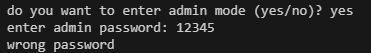
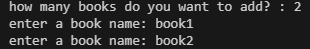

# Personall Book manager
This is a simple project for storing your books.


- this power priority:
```
low
medium
high
```

# Features
- Adding a few books
- Display Books
- Saving Books
- Reading saved books
- add priority
# Requirements
- python
- python-dotenv

## installation
installl the required package:

```bash
python -m pip install -r requirments.txt
```

## Envoirment setup
create a `.env` file in the project folder 

Use `.env.example`

add your admin password

```env
admin_pass=your_password_here
```

replace `your_password_here` with your own admin password

## run the program
run the main file
```bash
python main.py
```

## screenshot








## Demo


## project Structure

- main.py

- books.py

- .gitignore

- .env.example

- requirements.txt

- images/

## How It Works
1. The program asks for your name.
2. It welcomes you.
3. It asks if you want to use Admin Mode.
4. If you choose yes, it asks for your password.
5. It loads previously saved books.
6. You enter the number of books.
7. You enter the book names.
8. The program displays and saves your books.


## Troubleshooting

- Error FileNotFoundError
  
