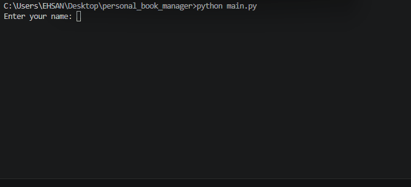

# Personall Book manager
This is a simple project for storing your books.

# Features
- Adding a few books
- Display Books
- Saving Books
- Reading saved books
  
# Requirements
- python
- python-dotenv

## installation
installl the required package:

```bash
python -m pip install -r requirments.txt
```

## Envoirment setup
create a `.env` file in the project folder 

Use `.env.example`

add your admin password

```env
admin_pass=your_password_here
```

replace `your_password_here` with your own admin password

## run the program
run the main file
```bash
python main.py
```

## screenshot


## Demo

